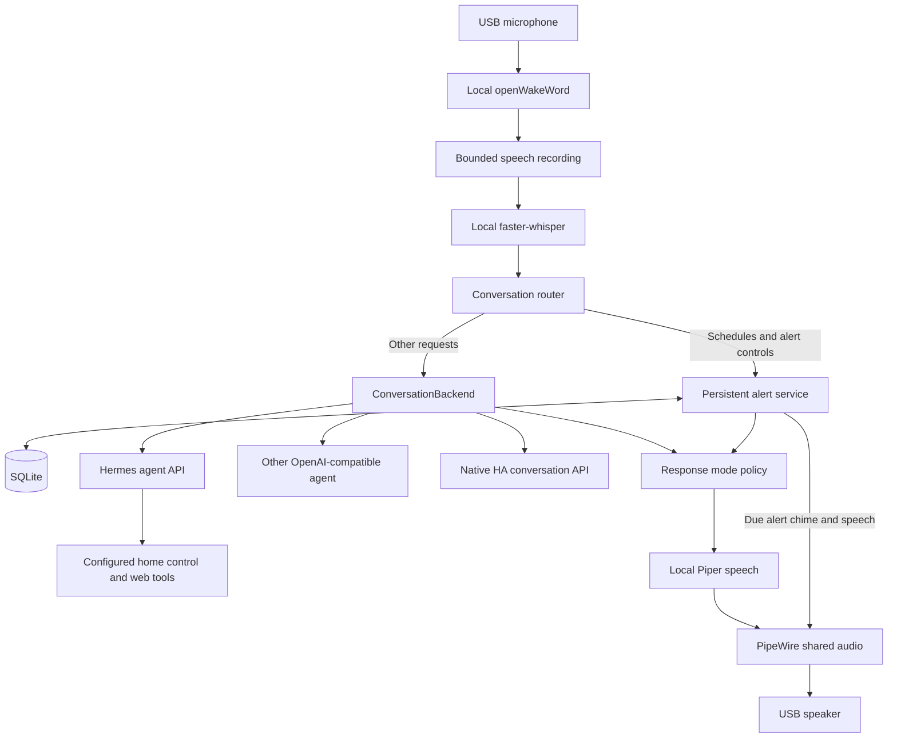

# Architecture

Jeeves separates local voice/audio and durable alerts from the selected conversation
agent. Hermes is the default agent adapter; native Home Assistant conversation and
other OpenAI-compatible agents are alternatives. Endpoints, keys, device names,
timezone and per-machine identity are private deployment configuration.

## Components

| Module / artifact | Responsibility |
|---|---|
| `jeeves/voice_audio.py` | PipeWire capture, wake models, VAD recording, Whisper recognition, Piper output |
| `jeeves/conversation.py` | Intercept local schedules and forward other requests to the selected backend |
| `jeeves/backends/` | Agent/HA protocols, authentication, conversation context, response categories |
| `jeeves/voice.py` | Serialized voice turns, response modes, local control API and listener lifecycle |
| `jeeves/alerts.py` | Durable schedules, deadlines, repeated audible alerts and alert API |
| `jeeves/configuration.py` | Host-derived setup defaults, audio selection and private configuration writes |
| `scripts/` | Installation, credential setup, control and smoke checks |
| `systemd/` | Templates rendered with the current checkout path |
| `locks/` | Pinned Python dependencies for separate voice/TTS environments |

## Voice request lifecycle

1. Detect the selected wake model locally (built-in Hey Jarvis by default).
2. Close capture while playing a wake cue, then record speech with pre-roll and VAD.
3. Transcribe locally using an on-disk Whisper base.en model, CPU int8 inference.
4. Handle mode/reset commands locally. Send schedule/control requests to the local
   alert service; send everything else to the selected conversation backend.
5. Apply the quiet/talkative policy to the returned `Reply`, then play local Piper speech.
6. Resume wake detection after playback and a refractory interval.

The initial recorder waits up to five seconds for speech, ends after one second of
silence, and records at most 20 seconds. Replies are shortened for speech after 1200
characters; the text API retains the full answer. There is no barge-in, streamed
playback or speaker identification. Each follow-up requires another wake activation.

## Backend boundary

`ConversationBackend.respond(text) -> Reply` and `reset()` are the frontend interface.
An OpenAI-compatible **agent** executes its own tools; the adapter rejects unexecuted
tool calls from underlying-model endpoints. Hermes-specific session headers are
configuration, not dependencies in the capture/recognition layer. Other wire protocols
need a new adapter registered in `create_backend`.

Native HA uses its conversation REST API and returned conversation ID. It does not
implicitly receive satellite room context; name rooms/devices explicitly. Hermes uses
its already configured toolsets. A voice session is separate from a messaging session,
so the voice prompt requests live entity/alias/area lookup before asking what a named
device is. No device entity IDs or room mappings are embedded in the source.

History is bounded to complete user/assistant pairs and resets after five minutes idle,
an explicit “new conversation”, or service restart. The default identity uses the
machine's hostname. Agent-side storage/memory follows that server's policy; local reset
does not delete remote history. There is no automatic backend fallback or action retry:
a timeout can occur after a remote action has already completed.

## Response modes

`Reply` includes `text`, `backend`, `success`, and `response_type`. Categories are
`action_success`, `answer`, `clarification`, `error`, and `unknown`.

Quiet mode suppresses only successful `action_success` confirmations. Answers,
clarification, failures, partial failures and unknown responses remain audible. Native
HA supplies categories from its response and failed targets; local alerts use confirmed
scheduler results. Generic agents are asked for final JSON metadata after tool execution.
Invalid/missing metadata stays audible. An agent's category is not independent proof
of a physical action. Scheduled alert playback bypasses the confirmation policy.

The original talkative behavior is the fallback for new configurations; the quickstart
selects quiet mode. Mode changes are local, immediate and persisted atomically.

## Persistent alerts

Each timer/alarm/reminder has its own SQLite record, ID and deadline. Creation commits
before returning confirmation. An optional `request_id` deduplicates a repeated request.
Up to 100 active alerts are supported. The independent scheduler does not rely on a
remote HA timer-finished event, conversation context, or network callback.

- Timers accept positive whole durations up to 366 days. English number words through
  ninety-nine and digit values are supported with seconds/minutes/hours/days.
- Alarms are one-shot next local occurrences; reminders accept a duration or local time.
  Missing/invalid times are rejected. DST gaps/folds are rejected instead of guessed;
  the command API also accepts explicit-offset ISO timestamps.
- Due alerts play chime plus local speech and repeat approximately every 15 seconds,
  for up to 15 minutes from the recorded ringing start. Concurrent alerts take turns.
- Restart resumes pending/ringing records. Pending alerts up to 24h overdue sound on
  recovery; older ones become missed. Restart does not reset a ringing time limit.
- Dismiss stops ringing records while preserving future schedules. Category cancel
  affects active records of that kind; `/cancel` with an ID targets one record.
- Missing speech synthesis still permits a chime. Audio failures are logged/retried
  within the ringing window. No sound can be produced while the machine is powered off.

Saved records and new local voice schedules work without an agent server after model
installation. Retain `.state/` in addition to code if existing schedules must survive
reinstall. NTP synchronization and the configured IANA timezone determine wall-clock deadlines.

## Processes and interfaces

| Service | Default binding | Interface |
|---|---|---|
| `jeeves-voice` | IPv4 loopback, port 5125 | Authenticated `/ask`, `/audio`, `/health`, `/mode`, `/last-turn` |
| `jeeves-alerts` | IPv4 loopback, port 5124 | Authenticated `/command`, `/alerts`, `/dismiss`, `/cancel`, `/health` |
| Optional LVA | Configurable LAN binding, port 6053 | ESPHome/HA-managed frontend, separate from standalone voice |

User systemd units run under the audio user's account; lingering starts them without
login. PipeWire, pipewire-pulse and WirePlumber share the device across playback clients.
Selection uses stable audio names, not numeric ALSA card indices. A missing selected
Jabra produces a failure rather than intentional fallback to another speaker.

Only one microphone frontend should start at boot. Installers disable the other when
switching between standalone Jeeves and optional LVA. Native HA conversation within
standalone Jeeves is a backend choice and does not require LVA or its HA package.

## Configuration and privacy

Private config lives under `~/.config/jeeves/` (directory 700, JSON/key files 600),
referenced by user-unit templates. New config discovers the Jabra, adopts the OS timezone,
uses a hostname-based session identity, and listens locally. Reinstallation preserves
existing private values. Explicit settings override discovery; no deployment address
or timezone is required in source control.

Microphone audio and conversation transcripts stay in RAM. Temporary synthesized WAVs
are deleted. `/last-turn` retains one authenticated local diagnostic for five minutes;
ordinary logs omit transcripts and keys. Reminder text is intentionally persisted in
SQLite. Remote agents may use cloud inference and their own retention policies.

The optional LAN alert API needs an explicit bind address, source-IP allowlist and
bearer key. HTTP is not encrypted; use a trusted LAN or a TLS/VPN boundary. Keys are
never sent through redirects. Backend endpoints should provide authenticated access
and only the tools appropriate to their deployment.

See [setup](QUICKSTART.md), [backend configuration](BACKENDS.md), and
[operations/recovery](EXECUTION.md) for commands. Hardware audio, actual device actions,
and cold-boot behavior require verification on each target machine; unit/HTTP tests
alone do not establish those outcomes.
